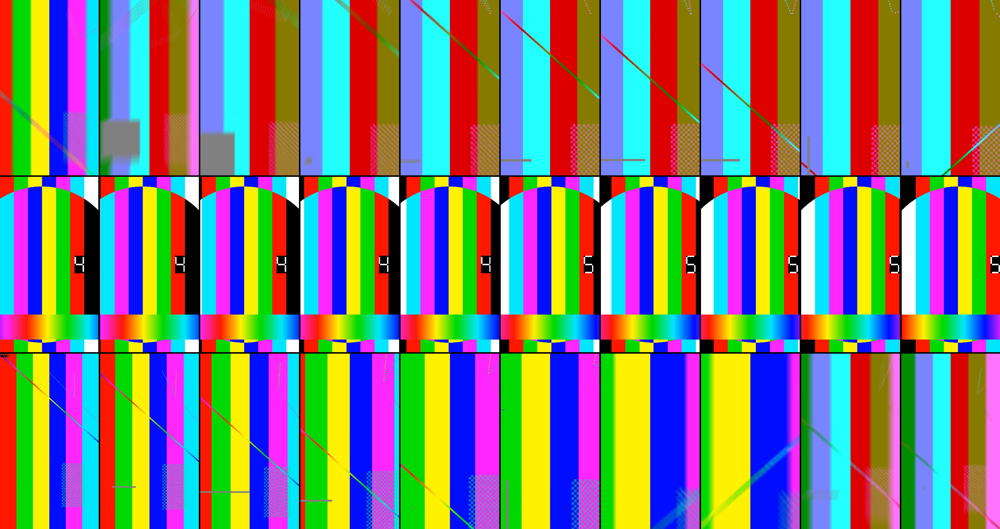

# 0076 - Camera moves as a library, and draft takes

Date: 2026-10-25

## Context

Higgsfield's Cinema Studio sells two things creators like: named camera moves
(crash zoom, dolly zoom, orbit, FPV fly-through) chosen from a list, and a
cheap draft to see a move before paying for the full take. ReelWalk had pieces
of both and no table:

- the AI director knew seven gimbal moves (ADR 0040: cathedral, twist, tilt,
  wide walk, pull back, detail orbit, static) as Veo sentences, in
  `ai-shots.ts`, as separate modes;
- footage already shot could be given an eased camera move (ADR 0067), a speed
  ramp (ADR 0067) and a zoom or streak blur on a cut (ADR 0073, 0074), each in
  its own sheet, none of them named for what a creator is trying to do;
- every AI take was a full Veo 3.1 Fast 1080p take (ADR 0049): a bad move
  cost the whole price, 1 credit for 4 s and 2 for 8 s.

## Decision

### One table (`packages/core/src/moves.ts`)

`MOVES` is the library: 26 moves, each with a label, a one-line blurb, a group,
and two sides.

- **AI side** (`ai`): the lens and what the hands do (the operator's words the
  panel already showed), the Veo prompt, whether it is locked off, the length
  that gives it room (4 s, 8 s for a fly-through or timelapse) and where it
  works (interior, exterior, either). Every prompt keeps the director's
  clauses: "Smooth gimbal motion, no cuts." (locked-off moves say "locked
  off ... no cuts"), and `movePrompt` appends "Keep the architecture, room
  layout, openings, furniture and materials unchanged." The seven existing
  moves keep their sentences word for word; `AI_CAMERA_MOVE_RECIPES` is now
  read from the table, so there is one place the words live.
- **Real side** (`real`): what is written onto a clip that is footage already
  shot, built only from what the editor already renders: eased camera keys
  (scale 1–2, shift up to 20 %), a speed-ramp preset, and a speed-ramp
  transition (zoom or streak blur) on the cut into the clip (`cutIn`) or into
  the next clip (`cutOut`). A move carries the real side only where a 2D crop
  can honestly do it. `real: null` means **AI-only**, with the reason in
  `aiOnly`.

| Move | Real (footage) | Real side is |
| --- | --- | --- |
| Slow push | yes | the eased `push` preset |
| Pull back reveal | yes | starts 1.22× and eases out to 1× |
| Super dolly in | yes | 1× to 1.9×, easing in, zoom blur into the next cut |
| Crash zoom | yes | 1× to 1.65× over the first tenth (snap ease), speed ramp `hit`, zoom blur on the cut in |
| Push through a doorway | yes | 1× to 1.95× accelerating, ramp `into-cut`, zoom blur into the next shot |
| Push, then settle | yes | the `push-settle` preset |
| Snap zoom | yes | the `snap` preset |
| Tilt-up reveal | yes | a 1.3× crop sliding from low to high |
| Crane down | yes | a 1.3× crop sliding from high to low |
| Parallax slide | yes | 1.14×, sliding ±6.5 % across |
| Handheld | yes | 1.06×, a seven-key drift of under 1 % |
| Static | yes | clears the eased move and the simple move |
| Whip pan right / left | yes | a speed-ramp transition with a horizontal streak into this shot (not the first shot) |
| Dolly zoom (vertigo) | AI only | it changes the perspective of the room against the subject; a crop scales both together |
| Orbit | AI only | shows the far side of the subject |
| Reveal from behind an object | AI only | the object has to move against the room |
| Rise over the roof | AI only | shows ground the footage never saw |
| Top-down spin | AI only | the frame has to rotate; a clip's camera only scales and shifts |
| Hyperlapse walk | AI only | it is a walk shot for the purpose |
| FPV fly-through | AI only | needs a path through rooms the footage never shows |
| Cathedral | AI only | rotation and parallax |
| Twist | AI only | the frame rolls |
| Wide walk | AI only | a walk through a room parallaxes; a digital push looks flat beside it |
| Detail orbit | AI only | shows the sides of the detail |
| Timelapse | AI only | the light has to change |

The real moves are digital: they crop and scale the picture, so they have no
parallax, and the sheet says so by marking the others AI. Every real move is
checked by test never to expose the frame's edge (shift never exceeds
`(scale − 1) × 50 %`, scale never above 2).

**Loops.** Each card plays a loop of its move on the clip's own picture. For a
real move the loop *is* the clip's camera maths (`cameraKeysAt`), so what the
card shows is what the clip will do; for an AI-only move it is a sketch in the
table (it may rotate) and the card carries an AI badge.

### The Moves sheet (ADR 0064: power where you tap)

The clip's Camera motion button now opens **Moves**, the old Eased move row
replaced by the cards grouped (Push in, Pull out, Reveals, Slides, Orbits and
spins, Whips, Fly-throughs, Locked off), the Simple move row kept at the
bottom. "Use a move on: This shot | A new AI shot".

- **This shot:** a real card is the command `applyMove { clipId, move }`, one
  undo step, and closes the sheet; a card whose move is AI-only goes to the AI
  side; a whip is disabled on the first shot with the reason. The card of the
  move already on the clip is pressed (`moveOnClip` compares the clip's camera
  keys with the table).
- **A new AI shot:** opens AI video with the move chosen and the move's whole
  Veo prompt in the box, to edit. The panel also has a Camera move select, for
  reaching the same from there.

### Commands and HTTP

- Command `applyMove { clipId, move }` (ADR 0048; in `COMMAND_TYPES`, so
  `POST /api/reels/:id/commands` takes it, singly or in a batch). It writes the
  move's camera, its speed ramp (video only) and its zoom or streak blur into
  the clip and, for a move that ends on a cut, into the next clip; no length
  changes and no title moves. It is refused, with the reason, for an AI-only
  move, a move or clip that is not there, and a cut-only move on the first
  shot; in a batch a refusal leaves everything as it was.
- `POST /api/ai/generations` accepts `move` (any id in the table; the shot's
  `move` is stored with it). The move's sentence replaces the shot type's own
  camera sentence in the prompt Veo gets, unless the studio's words already
  contain it (the sheet fills the box with the whole template, so it is not said
  twice). Without a shot, `{ prompt, move }` is a text-only take. A move is
  refused on a bridge, burst or construction timelapse, which have their own.
  The default length follows the move.
- `GET /api/moves` lists every move: id, label, group, whether it is AI-only
  (and why), what its real side writes, and the Veo prompt. Static.

### Draft takes

A draft is a preview of a take: **`veo-3.1-lite-generate-001`** (Veo 3.1 Lite,
Preview on Vertex since 2026-04-02), **720p**, silent, from a starting frame
(or words). Lite is the cheapest Veo that takes our request and does the
lengths we sell (4 and 8 s). Google's model table lists first-and-last-frame input for Fast
and Standard only and no reference images for Lite, so a draft with an ending frame (bridges, an end
reference) is refused up front. There is no 2-second option: every Veo 3.1
length is 4, 6 or 8 s.

**Prices.** Credits are whole numbers (a grant's `remaining` is an integer), so
a draft is **1 credit whatever its length**. The saving is on 8-second takes:
a draft is 1 credit against the full take's 2, and "Make it final" then costs
the rest (`aiFinalCredits`: the full price less the draft's credit, never less
than 1), so a draft you keep adds nothing: 1 + 1 = 2. On a 4-second take the
full price is already 1 credit, so a draft is an extra credit that buys time,
not credits; the panel says so and recommends drafts for 8-second takes. A
fractional credit would fix that and is left as a follow-up (it changes the
grant model).

Provider cost per second, reserved against the spend ceiling (all silent):

| | Model | Resolution | Reserved | Source |
| --- | --- | --- | --- | --- |
| Full take (unchanged) | `veo-3.1-fast-generate-001` | 1080p | 10 ¢/s (40 ¢ a 4 s take) | ADR 0049's figure, unchanged |
| Draft | `veo-3.1-lite-generate-001` | 720p | 5 ¢/s (20 ¢ a 4 s draft, 40 ¢ an 8 s draft) | Lite 720p $0.05/s |

Sources and doubt, stated plainly. Google's Vertex model page gives the
models, lengths and resolutions but no prices (it links to the cost page,
which would not load as text). Trackers quoting Google's rates give Lite at
$0.05/s at 720p and $0.08/s at 1080p (Gemini API, audio included) and Fast at
$0.10/s at 720p, $0.12/s at 1080p; one tracker puts Vertex's video-only Lite at
$0.03/s at 720p. Nothing here was confirmed against a Cloud billing SKU. The
draft reserves the higher $0.05; if Vertex's silent rate is $0.03 a 4 s draft
costs 12 ¢ and the ceiling is over-reserved, not under-.

**What a draft is, in the data.** No migration: the tier lives in the stored
shot (`shot.tier: "draft" | "final"`, `shot.seed`, `shot.finalOf`) and in the
generation's `model` (the Lite id) and `credits` (1). The browser asks with
`quality: "draft"`; the server picks a random seed (or keeps the caller's),
drops `draftReelId` (a promo reel is not assembled from a 720p preview), and
reserves 1 credit and the draft's cost. The worker asks Vertex for 720p when
the model is the draft model, sends the seed, and does not voice a draft: the
spoken line (lip sync or Veo audio) and its extra credit wait for the final.
A finished draft is saved to the library as "AI draft", 720 × 1280.

**Make it final.** `POST /api/ai/generations { requestId, prompt, finalOf }`
(the prompt only has to be 10 characters; it is ignored). The server reads the
draft's prompt, frames, presenter kit, composed-still descriptions and seed
back from its row, never from the browser, and reserves the full model at full
quality with `finalOf`. Inside the reservation, under the account lock (ADR
0049), the draft must be this workspace's and `SUCCEEDED`, must have `tier:
"draft"`, and must have no other non-failed final, and its credit is used
toward the price. Two taps cannot both use it (tested with two concurrent
reservations); a failed final returns exactly what it took and frees the draft
for another. The same prompt and seed are the closest reproducible settings:
Lite and Fast are different models, so the pictures will differ; a final is
the same ask, not the same pixels.

**Refunds and gates, unchanged in kind (ADR 0049/0056).** A draft is an
ordinary generation row, so every path applies: refused before submit
(frames unreadable, compose failed, identity gate rejected) refunds the credit
and the draft's budget; a definite refusal from Vertex (a 4xx with a rejection
code, including `NOT_FOUND` or `PERMISSION_DENIED` if Lite is not enabled for
the project) refunds; a submit with an unknown outcome is held `UNRESOLVED`,
never refunded or resent; a failed poll refunds. A draft with a composed still
runs the same compose and the same identity gate as a full take, and so does
the final (it composes again; a different still may result, and is gated
again). Voiced shots: the draft is silent and uncharged for voice; the final
charges it.

## Consequences

- Saved reels render as before: nothing in the timeline schema changed. A
  move written by `applyMove` is an ordinary `camera`, `ramp` and
  `transitionIn`/`speedRamp`, so a move survives anything else that reads
  those, and "Take the move off" is `setCamera null`.
- `applyMove` can change the next clip's transition (a push through a doorway
  puts a zoom blur there), replacing a transition the studio chose; it is one
  undo step and the sheet's note says what a move does.
- Applying a move does not undo the previous one's `cutIn`: crash zoom's zoom
  blur stays if a slow push is applied after it. Transitions belong to the
  Transition sheet.
- A draft's 720p output is upscaled when placed in a 1080p reel; it is a
  preview, and the library names it "AI draft".
- The Lite model is Preview on Vertex. If Google changes or retires it, the
  draft model is one constant (`AI_DRAFT_MODEL`); every draft would refuse and
  refund until it is changed.
- `AI_DRAFT_COST_CENTS_PER_SECOND` is an estimate (above); the first
  month's Cloud billing line for Lite is where to correct it.

## What was verified

- `pnpm check` (lint, typecheck of every package, every package's tests) passes
  with a throwaway Postgres for the db package (48 db tests including four new
  draft ones); `pnpm --filter @reelwalk/web build` passes; the worker entry
  imports under tsx and prints OK.
- `packages/core/tests/moves.test.ts` (62): table validity (20–30 unique
  moves, every id, group, lens, hands, a loop of finite poses; AI-only exactly
  where `real` is null, each with a reason and a sketch; the seven existing
  recipes word for word); every prompt has the keep-unchanged clause, "no cuts"
  and either "smooth gimbal motion" or "locked off"; every real camera parses,
  stays within scale 1–2, never shifts past `(scale − 1) × 50 %`, and is
  deterministic; crash zoom does over 85 % of its zoom in the first tenth and
  carries a zoom blur and the `hit` ramp; parallax slide is symmetric about
  centre; push through is accelerating (under a third of the zoom by halfway) and
  ends on a zoom-blurred cut; tilt and crane run opposite ways; `applyMove`
  changes no length or title, skips the cut-in on the first shot but refuses a
  whip there, writes the next clip's zoom blur for push through (and not on the
  last shot), skips the ramp on a photo, clears for static, refuses AI-only
  moves with the reason, and is all-or-nothing in a batch; `moveOnClip`; the
  draft model, resolution, reserved cents and credit formulas.
- `packages/core/tests/moves-generation.test.ts` (11): `move` reaches the
  stored shot and the prompt, sizes the take and is refused when unknown; a
  draft reserves the Lite model, the draft's cost, tier and a seed, keeps a
  caller's seed, is not charged voice, refuses an ending frame before reserving,
  drops the promo reel; Make it final reads everything from the draft row, is
  workspace-scoped, charges the voice with the final, and refuses an unfinished,
  non-draft or foreign draft; `/api/moves` lists every move.
- `packages/db/tests/ai-credits.test.ts` (four new, against Postgres): a draft
  is 1 credit and refunded once; a finished draft makes a final for the rest of
  the price, once, and a failed final returns its credit and frees the draft;
  another workspace's draft and a non-draft cannot be made final; two
  simultaneous "Make it final" taps use the credit once.
- `apps/worker/tests` (2 vertex, 5 worker new): the draft is asked of the Lite
  model at 720p with the seed and the final of the Fast model at 1080p with the
  same seed, and no seed is sent when a take has none; a draft refused outright
  refunds credit and budget, one with an unknown outcome is held and not resent;
  a draft is saved as "AI draft" 720 × 1280 and its line waits for the final.
- The renderer: `packages/render/scripts/moves.ts` draws, with the real
  composition, ten frames of each of three moves on test footage written by
  `applyMove` and checks none is near black (30 frames drawn, none dark).
  `docs/adr/assets/0076-moves.png` is that strip: top row, crash zoom (the cut
  and the frames after it, the zoom blur clearing as the picture settles
  closer); middle row, parallax slide (the picture sliding sideways across a
  closer frame; the pattern's counter and the frame's edge show the shift);
  bottom row, push through (the zoom growing and accelerating, then the cut into
  the next shot with the zoom blur). The fixture is ffmpeg test patterns, not
  property footage.

## What was not verified

- **No live Veo call, so no live draft against final.** The Vertex federation
  only admits the production task roles, this PC has no Google credentials, and
  the code is not deployed; the only way to a live proof was to deploy, which
  was not asked for. Nothing was spent. Unknown until the first live take:
  whether `veo-3.1-lite-generate-001` is enabled for the project, whether it
  accepts `image` input (Google's table is ambiguous for Lite), `generateAudio:
  false`, `personGeneration` and `seed`, and its real silent price. If it
  refuses outright, the take is refunded (tested at the worker) and the first
  draft shows the refusal. The owner workspace's ~3 credits were not touched.
- The Moves sheet and AI panel in a browser (no browser run here); they are
  type-checked and built, and their logic is the tested core.
- Real footage through the worker with a move applied and exported; the
  renderer check above is on test patterns.
